<div align="center">

# 🔎 Job Search

### Fresh jobs from 14 job boards, ranked against your resume

Finds jobs posted in the last 24 hours on LinkedIn, Naukri, Instahyre, Wellfound and more,<br>
scores every one against your resume, and gives you one page of apply links: best chances first.

**Built by Rahul Swargam** · [Visit my website ↗](https://rahulswargam.online/)


<picture>
  <source media="(prefers-color-scheme: dark)" srcset="docs/images/hero-dark.png">
  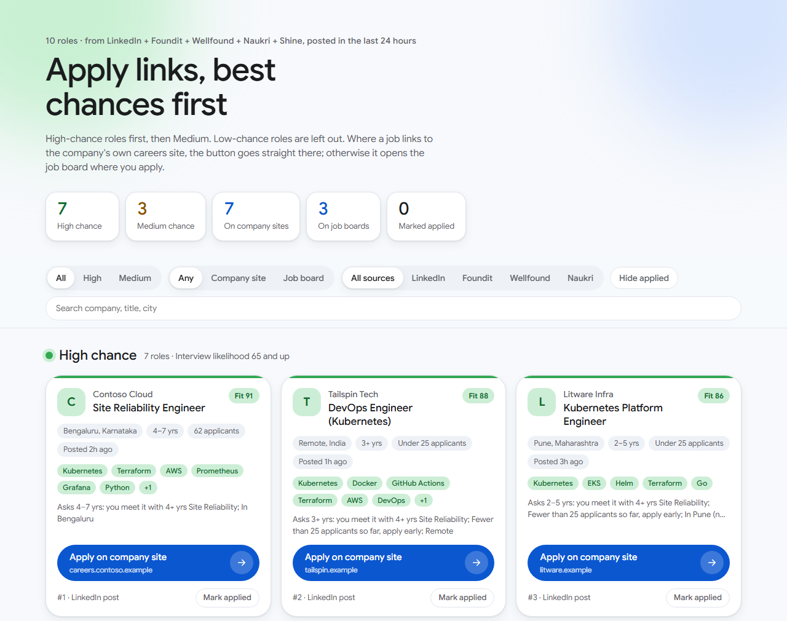
</picture>

<sub>Every screenshot in this guide uses a made-up resume, a demo Apify account and fictional companies.</sub>

</div>

---

## Contents

- [What it does](#-what-it-does)
- [Quick start: three steps](#-quick-start-three-steps)
- [A search, step by step](#-a-search-step-by-step)
- [The job links page](#-the-job-links-page)
- [One-click setup in detail](#-one-click-setup-in-detail)
- [Your key and resume stay private](#-your-key-and-resume-stay-private)
- [Credits and costs](#-credits-and-costs)
- [How jobs are scored](#-how-jobs-are-scored)
- [Commands and options](#-commands-and-options)
- [Troubleshooting](#-troubleshooting)
- [How it works](#-how-it-works)
- [What's been built](#-whats-been-built)
- [For developers](#-for-developers)

---

## ✨ What it does

| | |
|---|---|
| 🌐 **14 job sources** | LinkedIn, Naukri (3 versions), Instahyre (2), Hirist, a six-board India feed, Wellfound, remote company pages, We Work Remotely, 275k company career sites, Upwork (2) |
| 🕐 **Only fresh jobs** | Posted in the last 24 hours by default. Anything older is dropped before it's scored |
| 🎯 **Ranked for you** | Each job gets a resume match and an interview chance. You see High first, then Medium. Low and off-field roles are left out |
| 🔗 **One page of apply links** | `job_links.html`: one big button per job. It goes straight to the company's careers site when there's a link, otherwise to the job board |
| 💸 **Spends very little** | You see the most a search can cost before anything runs. Hard caps on every run. A typical search costs a few cents |
| 🎨 **Guided and colourful** | Four short steps with arrow-key menus. Nothing to memorise, nothing to edit |
| 🔒 **Private by design** | Your Apify key and resume location live in your own user environment variables, never in this public repo |
| 🖥️ **Runs on its own** | No AI service, no browser automation, no LinkedIn login. Everyone uses their own free Apify account |

---

## 🚀 Quick start: three steps

| Step | Windows 10 / 11 | macOS |
|:---:|---|---|
| **1. Get the code** | On GitHub, click **Code → Download ZIP** and unzip it, or `git clone https://github.com/rahulswargam/JobSearch.git` | Same |
| **2. Install everything (once)** | Double-click **`setup-windows.bat`** | In Terminal, in the project folder: **`bash setup-mac.sh`** |
| **3. Search** | Double-click **`jobsearch.bat`** | **`bash jobsearch.sh`** |

> [!TIP]
> You need a free Apify account for the job searches. The first search opens the [Apify API key page](https://console.apify.com/settings/integrations) for you; paste the key once and you're never asked again. The free plan includes $5 of credit every month.

Both launchers accept options too, for example `jobsearch.bat --dry-run` or `bash jobsearch.sh --dry-run` to see the plan and the most it can cost without spending anything.

---

## 🧭 A search, step by step

You move with the arrow keys (or press a number) and press Enter. **Nothing is spent until you choose _Run the search_.**

### Step 1 · Your Apify API key

The first time, Job Search looks for a key, says **No API key found**, and offers to open the Apify key page in your browser. Paste the key (it's hidden as you type). It checks the key with Apify, shows your account and credit, and saves it as the `APIFY_TOKEN` environment variable.

<p align="center">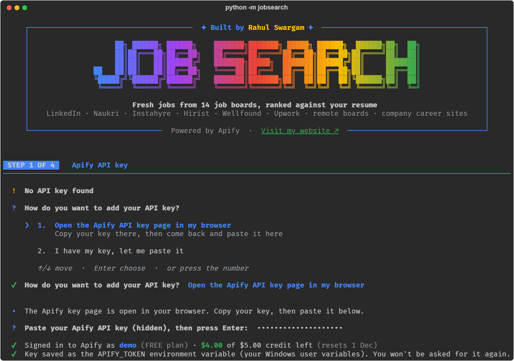</p>

Every run after that finds the key straight away. You choose **Continue with this key**, or **Change API key** to use another account, for example one with credit left.

<p align="center">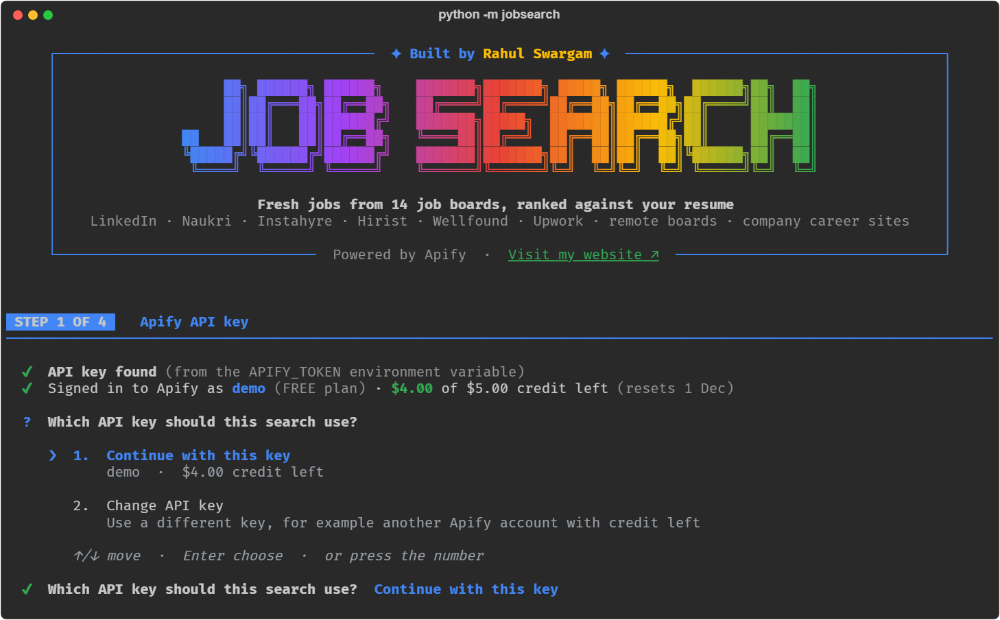</p>

### Step 2 · Your resume

Pick your resume (PDF, Word or text) in a file window the first time. After that you get two choices: **Use my previous resume** (one key press) or **Use an updated resume** (a file window opens; the new file becomes your saved resume).

It then shows what it read: your role, years of experience, city and skills, and what it will search for. Accept it, or change the role, location or cities.

<p align="center">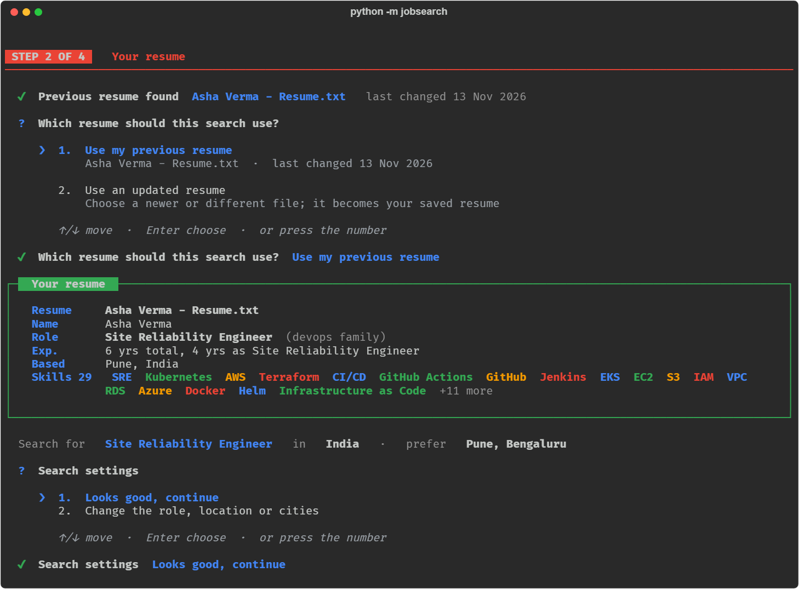</p>

### Step 3 · Job sources

Tick the boards to search with Space (A ticks all, N clears). Each row shows the most one run can cost, how many runs your credit covers and what you've used this month. The line under the list updates as you tick: **how much will be debited** and the credit you'll have left.

<p align="center">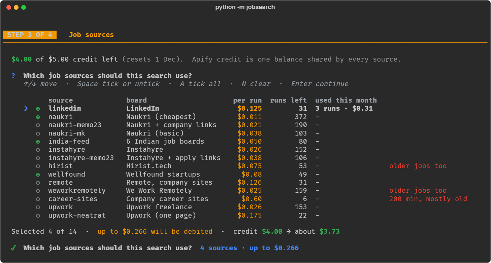</p>

### Step 4 · Where to save, then review

The page goes to `Downloads/JobSearch` unless you **Choose another folder**: a folder window opens and the path you pick is filled in for you. Your choice is remembered.

Then you see the full plan: each source, how many jobs it may return and the most it can cost. Choose **Run the search** or **Cancel**.

<p align="center">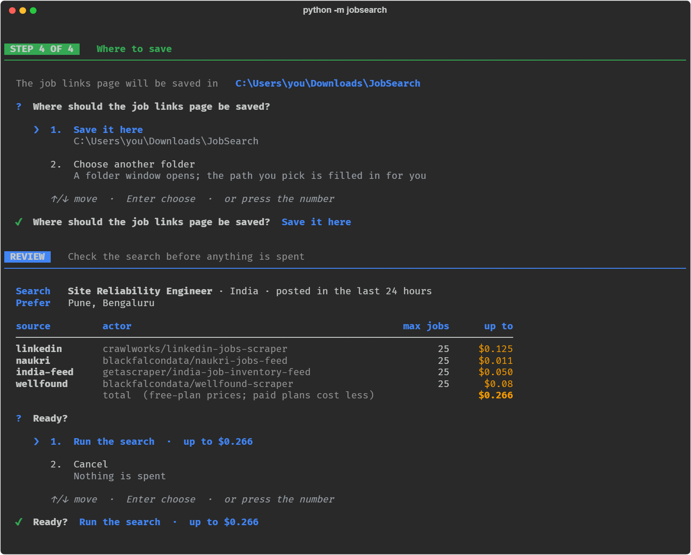</p>

### Running and results

A live table shows each source as it runs. At the end you get the count of High, Medium and Low jobs, what was dropped (too old, duplicates, outside your field), what the search cost, the top matches, and options to open the page or its folder.

<p align="center">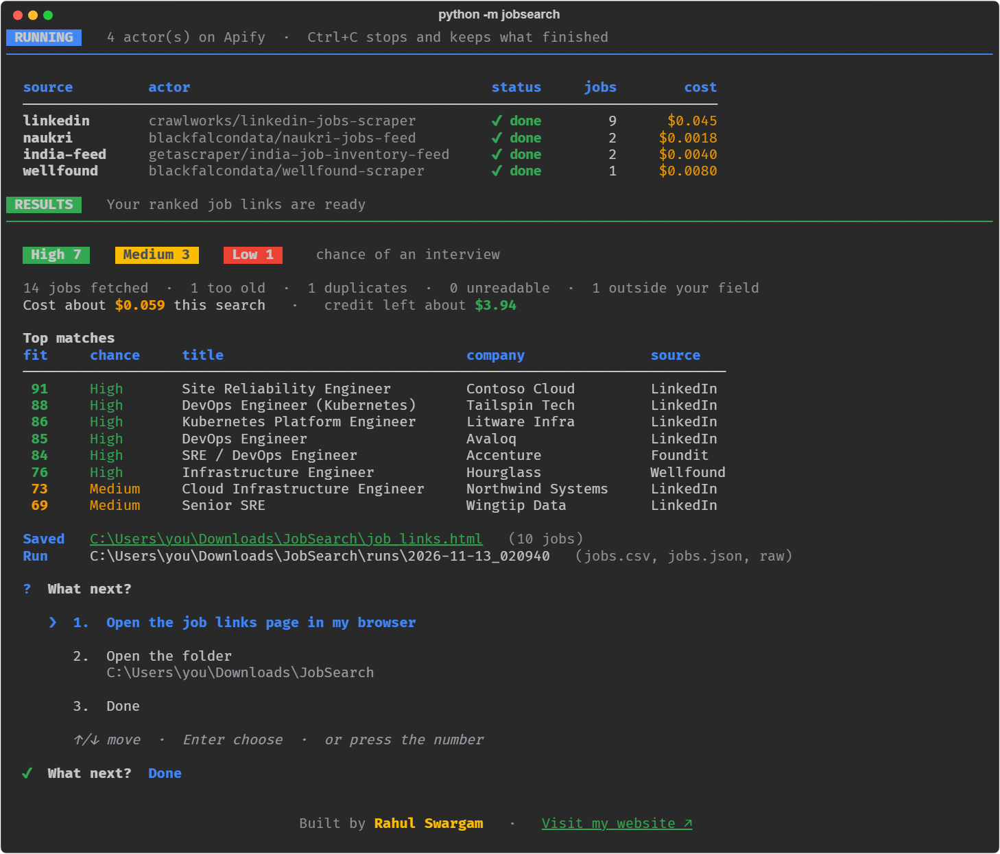</p>

---

## 📄 The job links page

`job_links.html` opens in your browser. It follows your system's light or dark mode.

<table>
  <tr><th>Light</th><th>Dark</th></tr>
  <tr>
    <td>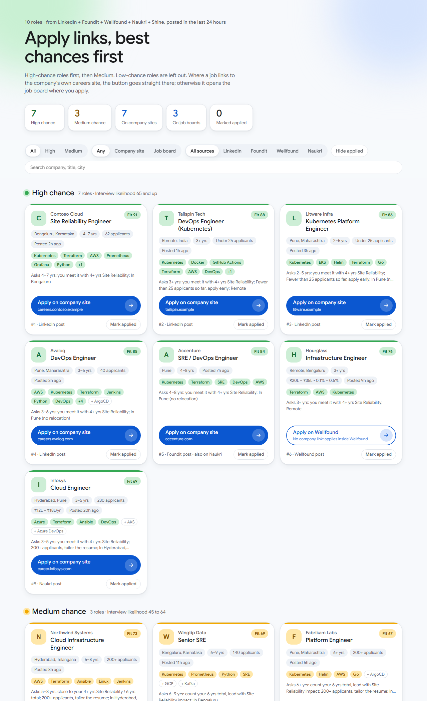</td>
    <td>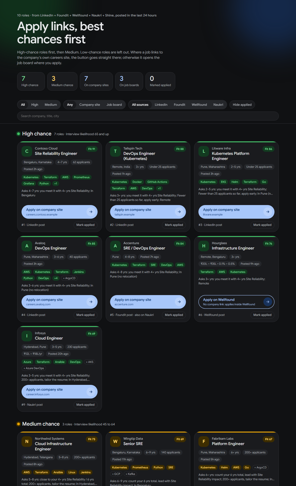</td>
  </tr>
</table>

- **High chance first, then Medium.** Each section is sorted by overall fit.
- **One big apply button per job.** _Apply on company site_ when the board gives the employer's link, otherwise _Apply on LinkedIn / Naukri / Wellfound_.
- **Why the chance is what it is**, in one line: years asked vs yours, applicant count, location.
- **Skills you match** in colour, plus a few to brush up (`+ ArgoCD`).
- **Filters and search:** by chance, by where you apply, by source, or type a company, title or city.
- **Mark applied** is remembered in your browser and carries over to the next day's page.

Everything is saved in the folder you chose:

| File | What it is |
|---|---|
| `job_links.html` | The latest page. Open this one |
| `runs/<date_time>/job_links.html` | That run's page |
| `runs/<date_time>/jobs.csv` | Every job with all its scores, Low ones included. Opens in Excel |
| `runs/<date_time>/jobs.json` | The same data as JSON |
| `runs/<date_time>/raw/` | What each source returned, so you can re-score for free later |

---

## 🧰 One-click setup in detail

One file per system installs everything Job Search needs, always at the **latest version**, then tests that it works. Run it again any time to update everything.

<p align="center">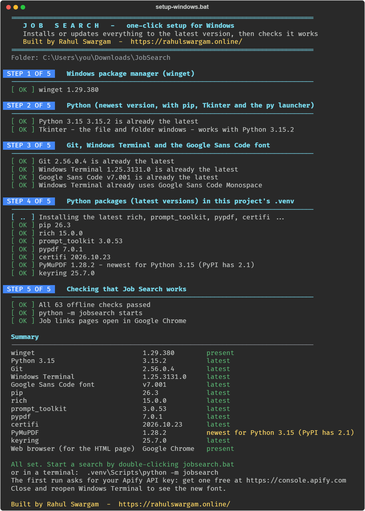</p>

| | Windows | macOS |
|---|---|---|
| Install or update everything | Double-click `setup-windows.bat` | `bash setup-mac.sh` |
| Preview only, change nothing | `setup-windows.bat /check` | `bash setup-mac.sh --check` |
| Run without questions | `setup-windows.bat /yes` | `bash setup-mac.sh --yes` |

<details>
<summary><b>Everything it installs</b> (click to open)</summary>

| Tool | What it's for | Windows | macOS |
|---|---|---|---|
| Package manager | installs and updates everything below | winget (built in) | Homebrew (installed if missing) |
| Python 3 (newest) | runs Job Search, with pip and venv | python.org build via winget, for your account | `python@3.x` from Homebrew |
| Tkinter | the resume file window and the save-folder window | included with Python | `python-tk@3.x` |
| rich | colours, tables, live progress | in `.venv` | in `.venv` |
| prompt_toolkit | arrow-key menus and checkboxes | in `.venv` | in `.venv` |
| pypdf | reads PDF resumes | in `.venv` | in `.venv` |
| certifi | up-to-date HTTPS certificates for the Apify API | in `.venv` | in `.venv` |
| PyMuPDF (optional) | better text from some PDF resumes | in `.venv` | in `.venv` |
| keyring (optional) | moves a key saved by an older version | in `.venv` | in `.venv` |
| Git | downloads and updates this project | Git for Windows | `git` |
| Terminal | full colours and clickable links | Windows Terminal | Terminal (built in) |
| Google Sans Code | the terminal font | installed for your account and set in Windows Terminal | Homebrew font cask |
| Web browser | opens the job links page | your default (Edge is built in) | your default (Safari is built in) |

The Python packages go into a `.venv` folder inside the project (ignored by Git), so they never clash with your other Python projects. `jobsearch.bat` and `jobsearch.sh` use it automatically.

</details>

> [!NOTE]
> `setup-windows.bat` is plain batch with no PowerShell, so antivirus tools don't mistake it for a script dropper. The careful parts (the font, Windows Terminal settings, checking PyPI for the newest versions, the self-test) are done by [`jobsearch/setup_helper.py`](jobsearch/setup_helper.py) using the Python it just installed.

---

## 🔒 Your key and resume stay private

This repository is public, so **nothing personal is ever written into it**. Your key and the location of your resume are saved as environment variables for your own user account and read back every run.

| Variable | Holds | Set when | Remove with |
|---|---|---|---|
| `APIFY_TOKEN` | Your Apify API key | You paste a key (first run, or **Change API key**) | `jobsearch.bat forget-key` |
| `JOBSEARCH_RESUME` | Where your resume file is. The file itself is never copied | You pick a resume (first run, or **Use an updated resume**) | `jobsearch.bat forget-resume` |

- **Windows:** your user environment variables, the same place `setx` writes. See them in System Properties → Environment Variables → User variables.
- **macOS / Linux:** `export` lines in your shell start-up file (`~/.zshrc`, `~/.bash_profile` or `~/.bashrc`), so every new terminal has them.
- The key is never written to the project folder, `config.json`, the output or any log.
- `config.json` (your search settings), `output/`, `.venv/`, `.env` files and every `*.pdf` / `*.docx` are in `.gitignore`, so a resume or key can't be committed by accident.

On macOS, use `bash jobsearch.sh forget-key` and `bash jobsearch.sh forget-resume`.

---

## 💰 Credits and costs

Apify credit is **one balance for your whole account**, shared by every source. The free plan gives $5 a month.

- **You always see the price first.** The source list shows the most each run can cost, and the review screen shows the total before you choose Run.
- **Hard spending limit.** Every run starts with Apify's `maxTotalChargeUsd` and `maxItems`, so it can't go past its cap. All caps together stay under your per-search budget ($0.50 by default; the guided run offers to raise it) and never above the credit you have left.
- **Fresh jobs only.** Each source's own date filter is set to your window, so you aren't billed for old posts where the source supports it.
- **Filters run on Apify's side.** Your role, location and experience go to the source, so jobs that don't fit are skipped before you pay for them.
- **25 jobs per source** by default (`--per-source`), and no paid extras (emails, enrichment, detail pages).
- **Re-score for free.** `rescore` re-ranks a saved run after you update your resume or settings, with no new Apify runs.
- **`--only-new`** asks sources that support it for jobs added since your last run, so a second search the same day costs almost nothing.

`jobsearch.bat credits` (or `bash jobsearch.sh credits`) shows your credit and the cost table without running a search.

<details>
<summary><b>All 14 sources and their prices</b> (click to open)</summary>

| Key | Board | Apify actor | Most per run, 25 jobs* | Notes |
|---|---|---|---|---|
| `linkedin` | LinkedIn | crawlworks/linkedin-jobs-scraper | $0.125 | Applicant counts, Easy Apply vs company link |
| `naukri` | Naukri | blackfalcondata/naukri-jobs-feed | $0.011 | Cheapest; full details and company apply link |
| `naukri-memo23` | Naukri | memo23/naukri-scraper | $0.021 | Employer's own apply link |
| `naukri-mk` | Naukri | muhammetakkurtt/naukri-job-scraper | $0.038 | Basic rows, one role per run |
| `india-feed` | Naukri, Foundit, Indeed, LinkedIn, Shine, Hirist | getascraper/india-job-inventory-feed | $0.050 | Six boards in one run |
| `instahyre` | Instahyre | getascraper/instahyre-jobs-scraper | $0.026 | No posting dates |
| `instahyre-memo23` | Instahyre | memo23/instahyre-jobs-scraper | $0.038 | External apply links |
| `hirist` | Hirist.tech | logiover/hirist-tech-scraper | $0.075 | No date filter: may bill older jobs |
| `wellfound` | Wellfound | blackfalcondata/wellfound-scraper | $0.080 | Startups, salary and equity |
| `remote` | Company career pages | hirebase/remote-jobs | $0.126 | Remote only, direct apply links |
| `weworkremotely` | We Work Remotely | inlifeprojects/weworkremotely-jobs-scraper | $0.025 | No date filter: may bill older jobs |
| `career-sites` | 275k company career sites | fantastic-jobs/career-site-job-listing-feed | $0.600 | 200 jobs minimum per run; mostly older jobs; not in `all` |
| `upwork` | Upwork | blackfalcondata/upwork-scraper | $0.026 | Freelance |
| `upwork-neatrat` | Upwork | neatrat/upwork-job-scraper | $0.175 | Freelance, one page of 10, 20 or 50 |

\* Free-plan prices taken from Apify in November 2026. Paid plans cost less, and actors can change their prices.

</details>

---

## 🎯 How jobs are scored

| Score | How it's worked out |
|---|---|
| **Resume match** (0–100) | The share of the job's skills that you have (skills in the title count double), plus how close the job title is to your role |
| **Interview likelihood** (0–100) | Years asked vs yours (it reads "6 years total, 4 as SRE" from a resume), applicant count, whether the job is in your city or preferred cities, and senior or junior titles |
| **Overall fit** | 0.55 × match + 0.45 × likelihood. The page is sorted by this |
| **Chance** | 🟢 **High**: likelihood 65+ · 🟡 **Medium**: 45–64 · 🔴 **Low**: under 45 (left off the page) |

A job with a resume match under 40 (`--min-match`) is treated as outside your field and left out.

If it misreads your resume (`jobsearch.bat profile` shows what it found), set the right values in `config.json` → `profile`: `years_total`, `years_relevant`, `title`, `city`, `extra_skills`, `ignore_skills`.

---

## 💻 Commands and options

On Windows run these as `jobsearch.bat <command>`; on macOS as `bash jobsearch.sh <command>`.

| Command | What it does |
|---|---|
| _(none)_ | The guided search |
| `credits` | Your Apify credit and what each source costs |
| `change-key` | Save a different Apify key |
| `forget-key` | Remove the saved key |
| `forget-resume` | Forget which resume you use |
| `profile` | Show what was read from your resume |
| `sources` | List every source with its actor and price (offline) |
| `init` | Create `config.json` step by step |
| `rescore <run folder>` | Re-score a saved run for free |

<details>
<summary><b>Search options</b> (click to open)</summary>

| Option | What it does |
|---|---|
| `--resume PATH` | Resume file (PDF, DOCX, TXT, MD); default is the resume saved last time |
| `--role "Title"` | Role to search for; repeat for more |
| `--location India` | Where to search. A country covers all of it; `Remote` searches remote jobs |
| `--prefer City` | A city you'd work in (scores higher); repeat for more |
| `--sources a,b` | Which sources, skipping the checkbox list (`all` = all but `career-sites`) |
| `--per-source 25` | Max jobs per source, which is what you pay for |
| `--posted 24h` | Freshness window: `24h`, `3d`, `7d`, `30d` |
| `--budget 0.5` | Spending cap per search, in USD |
| `--min-match 40` | Leave out jobs below this resume match |
| `--remote-only` | Remote jobs only, where the board supports it |
| `--only-new` | Only jobs new since your last run (for sources that support it) |
| `--dry-run` | Show the plan and the most it can cost; spends nothing, no key needed |
| `--out FOLDER` | Where to save the page, skipping step 4 |
| `-y` | No menus: uses the saved resume, `APIFY_TOKEN` and `config.json` (for scheduled runs) |
| `--open` | Open the page when done |

</details>

**Run it every morning (optional).** Do one search by hand first so your key, resume and folder are remembered. Then schedule the setup's Python directly (the launchers wait for a key press at the end, which a scheduled task can't give):

- **Windows Task Scheduler:** program `.venv\Scripts\python.exe` (inside the project folder), arguments `-m jobsearch -y`, start in the project folder.
- **macOS cron:** `cd /path/to/JobSearch && .venv/bin/python -m jobsearch -y`

---

## 🩺 Troubleshooting

<details>
<summary><b>Windows says "Windows protected your PC" or asks before running a .bat file</b></summary>

Files from a downloaded ZIP are marked as coming from the internet. Click **More info → Run anyway**, or before unzipping, right-click the ZIP → **Properties** → tick **Unblock** → OK.
</details>

<details>
<summary><b>"python is not recognized" or the window closes straight away</b></summary>

Run `setup-windows.bat` first. It installs Python and creates the `.venv` that `jobsearch.bat` uses.
</details>

<details>
<summary><b>The terminal doesn't show the Google Sans Code font</b></summary>

Close every Windows Terminal window and open it again. To set it by hand: Settings → Defaults → Appearance → Font face → **Google Sans Code Monospace** (that exact name; plain "Google Sans Code" isn't found). On macOS: Terminal → Settings → Profiles → Text → Font → **Google Sans Code**.
</details>

<details>
<summary><b>Colours or boxes look broken</b></summary>

Use Windows Terminal (the default on Windows 11), the macOS Terminal, iTerm2 or VS Code's terminal. The old console window has limited colours.
</details>

<details>
<summary><b>Setup says PyMuPDF is "newest for Python 3.15 (PyPI has 2.1)"</b></summary>

That's expected. PyMuPDF 2.x needs onnxruntime, which has no build for Python 3.15 yet, so setup keeps the newest version that installs. PyMuPDF is optional: pypdf reads PDF resumes either way.
</details>

<details>
<summary><b>macOS: "permission denied" when starting jobsearch.sh</b></summary>

Start it with `bash jobsearch.sh`, which always works. To use `./jobsearch.sh`, run `chmod +x jobsearch.sh` once.
</details>

<details>
<summary><b>macOS: setup asks for a password</b></summary>

That's Homebrew asking for your Mac's own password to install into `/opt/homebrew` (or `/usr/local` on Intel). Type it in Terminal; it isn't shown or stored by Job Search.
</details>

<details>
<summary><b>I'm out of Apify credit</b></summary>

Pick **Change API key** at the start of a search to use another Apify account, or wait for your monthly reset (the date is shown next to your credit).
</details>

<details>
<summary><b>A source found 0 jobs</b></summary>

Nothing matched in the last 24 hours on that board. Try `--posted 3d`, a broader `--role`, or a country instead of a city for `--location`.
</details>

---

## 🔧 How it works

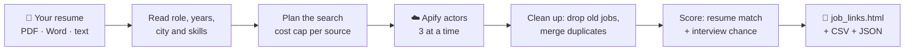

1. **Read the resume:** role, total and relevant years, city, skills.
2. **Plan:** turn your role, location, experience and freshness window into each actor's own input, with a cost cap per run.
3. **Fetch:** run the chosen actors on Apify (three at a time), with `maxTotalChargeUsd` and `maxItems` on every run.
4. **Collect:** convert every board's format to one job format, drop jobs older than your window, and merge the same job seen on several boards.
5. **Score and write:** rank by overall fit and write the page, the CSV and the JSON.

---

## 🧱 What's been built

| Part | What it does |
|---|---|
| **Guided CLI** | The four-step search with a gradient banner, arrow-key menus, checkboxes with a live "will be debited" total, file and folder windows, a live run table and a results screen. Works on Windows and macOS |
| **Key and resume memory** | Finds `APIFY_TOKEN` automatically, asks for a key only once, offers **Change API key** every run, and remembers your resume as **previous** or **updated**. Both live in user environment variables, never in the repo |
| **14 source adapters** | One small class per Apify actor that builds its input and reads its results into one common job format |
| **Cost control** | Price shown before running, hard Apify caps, per-search budget, credit check, free re-scoring |
| **Resume reader and scorer** | Reads PDF, Word and text resumes, works out role family, years and skills, then scores match and interview chance |
| **Job links page** | A single HTML file in a clean card design with light and dark modes, filters, search and "Mark applied" |
| **One-click setup** | `setup-windows.bat` and `setup-mac.sh` install or update every tool to its latest version, set the terminal font and test the result |
| **Launchers** | `jobsearch.bat` and `jobsearch.sh` start a search with the setup's Python |
| **Offline tests** | 63 tests that never call Apify: resume reading, every source's format, scoring, the page, the guided run with a fake Apify account, the menus driven by simulated keys, saving the key and resume on Windows and macOS, and the setup files |

---

## 🧩 For developers

<details>
<summary><b>Use it from a web app</b></summary>

The pipeline doesn't depend on the command line. A web backend can call the same functions with the key each user enters:

```python
from jobsearch import core, report, resume, sources
profile = resume.build_profile("upload.pdf")
search  = core.build_search(profile, settings)       # settings: same keys as config.json
prefs   = core.build_prefs(profile, search, settings)
planned = core.plan(search, sources.resolve(settings["sources"]), budget=0.5)
raw     = core.fetch(user_token, planned)
jobs, _ = core.collect(raw, search, profile, prefs, sources.BY_KEY)
html, cards = report.render(jobs, sources_used=["LinkedIn", "Naukri"], hours=search.hours, profile=profile)
```
</details>

<details>
<summary><b>Add an Apify actor</b></summary>

Each actor is a small class in `jobsearch/sources.py`. `build_input()` turns the search into the actor's input and `normalize()` turns one result row into a job. Add the class to `ALL` and its Apify ID to `ACTOR_IDS`, add a sample row to `tests/fixtures/samples.json`, and run the tests.
</details>

<details>
<summary><b>Run the tests</b></summary>

```bash
python -m unittest discover -s tests -v
```

They run offline and never call Apify. Setup runs them too, as its last step.
</details>

<details>
<summary><b>Project layout</b></summary>

| Path | What it is |
|---|---|
| `jobsearch.bat`, `jobsearch.sh` | Start a search (Windows, macOS) |
| `setup-windows.bat`, `setup-mac.sh` | One-click setup: install or update every tool to the latest version |
| `jobsearch/cli.py` | Commands and the guided steps |
| `jobsearch/ui.py` | Colours, banner, arrow-key menus, checkboxes, file and folder windows |
| `jobsearch/keystore.py` | Saves and reads `APIFY_TOKEN` and `JOBSEARCH_RESUME` as user environment variables |
| `jobsearch/core.py` | Pipeline: plan, run actors, collect, de-duplicate |
| `jobsearch/sources.py` | One adapter per Apify actor |
| `jobsearch/apify.py` | Small Apify API client with spending caps |
| `jobsearch/resume.py` | Reads the resume: role, years, skills, city |
| `jobsearch/scoring.py` | Match, likelihood, overall fit, chance |
| `jobsearch/skills.py`, `roles.py` | Skill dictionary, role families, cities |
| `jobsearch/report.py`, `templates/` | The job links page, CSV and JSON |
| `jobsearch/setup_helper.py` | Setup's helper: font, Terminal settings, PyPI versions, self-test |
| `tests/` | Offline tests and made-up fixtures |
| `docs/images/` | The screenshots in this guide |

</details>

---

<div align="center">

Built by **Rahul Swargam** · [Visit my website ↗](https://rahulswargam.online/)

</div>
